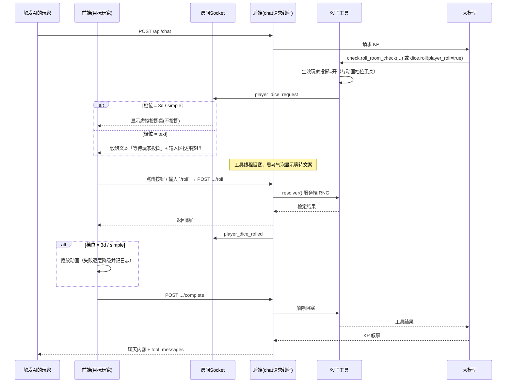

# 现代化骰子动画与玩家投掷 · 功能开发文档

- 文档状态：已评审（v3，含外观个性化、贴图皮肤与 `/roll` 指令）
- 编写日期：2026-10-21
- 目标版本：v0.5.1b
- 影响范围：管理员设置、房间规则、AI 骰子工具、聊天窗口、Socket 事件、房间 API、房间日志、控制台命令、用户个性化、贴图管理
- 关联模块：`agents/tools/dice.py`、`agents/config.py`、`routes/rooms.py`、`routes/chat.py`、`room_log.py`、`room_console_commands.py`、`console_commands.py`、`dice_textures.py`、`routes/dice_textures.py`、`frontend/src/app/chat.ts`、`frontend/src/tools/diceTool.ts`、`frontend/src/app/dice-appearance-settings.ts`、`frontend/src/app/admin-dice-textures.ts`

---

## 1. 背景与目标

现有骰子结果只在聊天里以纯文本出现（如「侦察检定：1d100=34，目标 45，结果：成功」），
缺乏视觉反馈。本次改造希望在**不破坏现有骰子指令、工具名与返回结构**的前提下：

1. 骰子动画改为三档：**纯文本 / 简易骰子动画 / 3D 骰子动画**，管理员设置全局默认（默认 3D），房间可覆盖。
2. AI 每次调用骰子时，在聊天窗口内生成「虚拟投掷桌」，以俯视角播放 3D 骰子动画
   （参考：`https://github.com/Matteas-Eden/dice-roller`）。
3. 简易骰子动画作为中间降级档（参考：`https://www.suijimm.com/dice/`）。
4. 保留原有纯文本结果输出，作为最终兜底；降级采用 `3D → 简易 → 纯文本` 逐层降级，
   **每次降级及报错都写入房间日志**。
5. 增加「玩家投掷骰子」开关（管理员默认 + 房间覆盖）：开启后，AI 需要玩家检定时
   自动摆好骰子但不投掷，等待被请求的玩家点击「投掷」或输入 `/roll`，再把结果返回给 AI。
   玩家投掷**不再依赖**动画档位，纯文本 / 简易 / 3D 下均可使用。
6. 通用投掷工具新增两个可选参数并对 AI 开放：
   - `show_table`：本次投掷召唤虚拟投掷桌；
   - `player_roll`：本次投掷改由玩家点击完成（仅在房间生效玩家投掷开启时有效）。
7. 允许引入经过许可的 3D/物理库，以获得真实的骰子-桌面、骰子-骰子碰撞效果。
8. 所有新增参数进入系统设置，后端有明确校验、日志与超时兜底。
9. 补充 API 文档、wiki 文档、房间控制台命令与管理员控制台命令。
10. 桌面与骰子的颜色支持玩家个性化：在用户设置中提供选色板，只影响该玩家本机显示。
11. 管理员可上传桌面贴图、骰子逐面贴图与皮肤套装；玩家可选择管理员上传的贴图，
    骰子贴图支持按面（1–20 / 0–9）逐面自定义。
12. 新增 `/roll` 指令：在任意动画档位下完成当前等待中的投掷；`/roll force` 允许
    站点管理员、房主或房间管理员强制投掷，不再校验目标玩家身份。

### 非目标

- 不改变前端指令 `/dice`、`/check`、`/sc` 的语法和输出文本。
- 不改变现有工具名、必填参数、已有返回字段；通用投掷只**新增可选参数**，
  其余工具只在 `visible_message.metadata` 中**追加**展示用字段。
- 不为骰子动画单独做设置页，动画相关开关统一放在现有「骰娘设置」区块。
- 首版不追求 100% 复刻参考仓库的全部交互（选骰界面、URL 参数等），
  只复刻其骰子模型、物理手感、桌面效果与俯视镜头。

---

## 2. 名词与生效规则

| 名词 | 说明 |
| --- | --- |
| 动画档位 | `text`（纯文本）/ `simple`（简易动画）/ `3d`（3D 物理骰子） |
| 虚拟投掷桌 | 聊天消息内嵌的桌面组件，用于展示骰子与结果 |
| 玩家投掷模式 | AI 只摆骰不投掷，等待目标玩家点击后播放动画并返回结果 |
| 目标玩家 | 本次检定对应的玩家（`player_name` 或触发 AI 的 `user_id`） |
| 生效值 | 房间规则优先；房间未设置（`null`）时继承管理员默认 |
| 降级 | 当前档位运行失败时，按 `3d → simple → text` 逐层回退，并写房间日志 |

**硬约束**

1. 玩家投掷模式**不依赖动画档位**：`text` / `simple` / `3d` 均可开启；管理员与房间规则不再做联动置灰或冲突校验。
2. 运行时动画降级不影响等待流程：3D 失败降级简易、简易失败降级纯文本，玩家投掷照常完成，但必须记录房间日志。
3. 暗投（`dark=true`）永远不召唤桌面、不等待玩家。
4. 纯文本档位下，等待期间骰娘输出「等待玩家投掷」；触发玩家可通过聊天输入区的投掷按钮或 `/roll` 完成投掷。
5. 颜色与贴图是个性化显示设置，只影响本机渲染，不改变服务端结果、其他玩家画面或 AI 上下文。
6. `/roll` 默认只能由目标玩家使用；`/roll force` 仅站点管理员、房主或房间管理员可用。

---

## 3. 现状梳理

### 3.1 后端

- [dice.py](file:///c:/Users/19826/Desktop/Mine/AIbased%20TRPG/backend/trpg_server/agents/tools/dice.py)
  - `roll_room_check()`、`roll_coc_check()`、`roll_sanity_check()`、`roll_dice()` 为纯函数；
  - `execute_*` 为 Agent 包装；`ROLL_DICE_TOOL` 当前仅支持 `expression`、`dark`
    （L401-L402），需新增 `show_table`、`player_roll`；
  - `_result_message()` 生成 `visible_message`，需支持追加 metadata。
- `routes/chat.py`
  - AI 请求内同步执行工具，`tool_messages` 随 HTTP 响应返回；
  - `tool_state` 提供 `thinking_stage_callback`，可更新等待阶段的思考气泡。
- `routes/rooms.py`
  - `HOUSE_RULE_DEFINITIONS` 现有 `boolean`、`nullable_integer`、`skill_bases` 等类型；
  - 房规 GET/PUT：`/api/rooms/<room_id>/house-rules`。
- [room_log.py](file:///c:/Users/19826/Desktop/Mine/AIbased%20TRPG/backend/trpg_server/room_log.py)
  - `log_room_event()`（L252-L295）统一写 `console.jsonl` 并广播；
  - 条目结构：`ts/level/source/actor/room_id/message/details`；
  - 归档时按 `load_room_log()` 一并保存。
- 控制台：
  - 管理员：[console_commands.py](file:///c:/Users/19826/Desktop/Mine/AIbased%20TRPG/backend/trpg_server/console_commands.py)
    按 domain 分发，写操作遵循 `--yes/-y` 确认约定；
  - 房间：[room_console_commands.py](file:///c:/Users/19826/Desktop/Mine/AIbased%20TRPG/backend/trpg_server/room_console_commands.py)
    使用 `ROOM_COMMAND_WHITELIST` + `room_command_help_text()`，仅限本房间。
- `server.py` 为多线程 WSGI；Socket.IO 为 `threading` 模式，允许工具线程阻塞等待。

### 3.2 前端

- [chat.ts](file:///c:/Users/19826/Desktop/Mine/AIbased%20TRPG/frontend/src/app/chat.ts)
  - 收到 `tool_messages` 后持久化并 `renderRoomMessage()`；
  - `type === "dice"` 使用现有 `dice-message` 样式；SAN 结果会同步角色状态。
- [diceTool.ts](file:///c:/Users/19826/Desktop/Mine/AIbased%20TRPG/frontend/src/tools/diceTool.ts)
  - 负责前端 `/dice` 本地投掷与阈值面板，不参与 AI 工具结果。
- 构建：`tsc` 输出全局脚本 + `esbuild` 单独打包 React；已安装 `esbuild`，
  可将 3D 渲染器打包为独立按需加载 bundle。
- 设置页：
  - 管理员：`03-room-tools-auth-settings.html` + `tabs.ts` + `ConfigManager.ts`；
  - 房间：`roomHouseRulesModal` + `rooms.ts`；
  - 管理员设置沿用「改动待保存 + 确认」机制。

---

## 4. 需求拆解

### 4.1 管理员默认设置（第一级）

在「设置 → 常规设置 → 骰娘设置」新增：

| 控件 | 类型 | 默认值 | 说明 |
| --- | --- | --- | --- |
| 骰子动画档位 | 下拉：纯文本 / 简易 / 3D | **3D** | 全局默认；房间可覆盖 |
| 允许玩家投掷骰子 | 开关 | 关闭 | 全局默认；房间可覆盖；不依赖动画档位 |
| 玩家投掷等待超时（秒） | 数字 30–300 | 120 | 超时自动投掷，避免 AI 永久等待 |

- 三项都纳入「改动待保存」栏，点击保存后写入 `general.toml`。
- 玩家投掷开关不依赖动画档位，纯文本 / 简易 / 3D 下均可开启。
- 玩家投掷开关关闭时，超时输入框置灰，仍保留已保存值。

### 4.2 房间级覆盖（第二级）

在「房间规则」弹窗新增两个下拉框：

| 规则 | 选项 | 默认 |
| --- | --- | --- |
| 骰子动画档位 | 跟随管理员默认（当前：纯文本/简易/3D） / 纯文本 / 简易 / 3D | 跟随 |
| 玩家投掷骰子 | 跟随管理员默认（当前：开/关） / 开启 / 关闭 | 跟随 |

- 玩家投掷不依赖动画档位，可与任意档位自由组合。
- 保存成功后返回并刷新 `house_rules` 与 `dice_animation`。

### 4.3 自动骰子动画

- 生效档位为 `3D` / `简易` 时，AI 的检定工具在对应骰娘消息内嵌虚拟投掷桌并播放对应动画。
- 通用 `NdM` 默认不召唤桌面（保持轻量）；仅当 `show_table=true` 或 `player_roll=true` 时召唤。
- 暗投不召唤桌面。
- 实时消息播放动画；加载历史记录时静态展示最终骰面，避免刷屏。
- 生效档位为 `纯文本` 时不创建桌面，只显示原有文本摘要。

### 4.4 玩家投掷模式

触发范围：

| 工具 | 是否等待 | 目标玩家解析 |
| --- | --- | --- |
| `check.roll_room_check` | 是（生效玩家投掷开启时） | `player_name` |
| `dice.roll_coc_check` | 是（能解析到当前房间玩家时） | `character_name` 或 `context.user_id` |
| `san.roll_sanity_check` | 是（生效玩家投掷开启时） | `player_name` |
| `dice.roll` + `player_roll=true` | 是（生效玩家投掷开启时） | 触发 AI 的 `user_id` |
| `dice.roll`（未传参数） | 否 | 即时返回 |
| `dark=true` | 否 | 即时返回，不召唤桌面 |

流程：

1. AI 调用工具 → 工具检测到需要等待。
2. 生成待投掷请求（骰型、数量、面数、检定名、难度、目标值、奖励/惩罚骰），
   广播 `player_dice_request`，思考气泡显示「等待 <玩家> 投掷骰子…」。
3. 前端根据生效档位展示：
   - `3D` / `简易`：在聊天中插入虚拟投掷桌，目标玩家可点击「投掷」；
   - `纯文本`：骰娘在聊天中输出「等待玩家投掷」，触发玩家的聊天输入区出现「投掷骰子」按钮。
   - 三种档位下，目标玩家都可以直接输入 `/roll` 完成投掷。
4. 目标玩家点击按钮或输入 `/roll` → 前端调用 `roll` 接口 →
   后端用服务端 RNG 产生权威结果，返回骰面并广播 `player_dice_rolled`。
5. 前端播放当前档位动画（纯文本跳过动画）；动画结束后调用 `complete` 接口；
   纯文本模式在收到结果后立即调用 `complete`。
6. 后端解除工具阻塞，结果返回 AI，AI 继续叙事；其他玩家同步看到同一结果。

`/roll force`：

- 站点管理员、房主或房间管理员可用；
- 对当前房间唯一的待投掷请求立即以服务端自动投掷方式结算，不校验目标玩家身份；
- 广播 `player_dice_forced`，所有端直接显示结果；目标玩家的等待状态解除。

超时与兜底：

- 等待超过配置时间 → 自动投掷，标注「等待超时，系统自动投掷」。
- 目标玩家不在线/已退出 → 自动投掷，标注「目标玩家不在线，系统自动投掷」。
- 动画完成后客户端未回调 `complete`（如关页）→ 服务端在投掷后 5 秒自动完成。
- 房主/房间管理员可 `cancel`：取消并返回「投掷被管理员取消」。
- 房主/房间管理员可 `force`：强制该请求立即自动投掷。

### 4.5 通用投掷新增参数（对 AI 开放）

`dice.roll` / `dice.roll_dice` 的 schema 追加：

```json
{
  "show_table": {
    "type": "boolean",
    "description": "Set true to summon the virtual dice table for this roll. Ignored in text-only animation mode."
  },
  "player_roll": {
    "type": "boolean",
    "description": "Set true to let the current player throw the dice. Only honored when player-roll mode is enabled; otherwise the roll resolves immediately. Works in text, simple, and 3D animation modes."
  }
}
```

行为：

- `show_table=true`：召唤桌面并播放当前档位动画。
- `player_roll=true`：隐含 `show_table=true`，等待发起 AI 请求的玩家点击。
- 生效玩家投掷关闭时，`player_roll` 被忽略并即时投掷；结果 metadata 标记
  `player_roll_ignored: true`，服务器 `logger.info` 记录，不写房间日志（避免噪声）。
- `dark=true` 时两个参数都被忽略，避免泄密。
- 在 `纯文本` 档位下 `show_table` 被忽略，仅输出文本。

### 4.6 逐层降级与房间日志

| 当前档位 | 失败原因示例 | 降级动作 | 记录 |
| --- | --- | --- | --- |
| 3D | bundle 加载失败、WebGL 不可用、物理库初始化异常、单次渲染异常 | 本次（或本会话）改用简易动画 | 写房间日志，`source=dice_animation` |
| 简易 | DOM/动画 API 异常 | 改用纯文本 | 写房间日志 |
| 纯文本 | 不存在渲染 | 无 | 无 |

- 全局性失败（bundle/WebGL）在**本会话**只记录一次，并记住降级状态，后续不再尝试 3D。
- 单次性失败（如某个骰型几何构建异常）每次都记录，但房间级限流 30 条/分钟。
- 记录内容包含：`from_level`、`to_level`、`reason`、`error`、`dice`、`tool_name`、
  `request_id`、`scope`（`session` / `roll`）、操作者。
- 降级不影响 AI 结果，只影响视觉层。

### 4.7 桌面与骰子外观个性化

**颜色**

在「用户设置 → 外观偏好」新增「骰子外观」区域，提供：

| 项目 | 控件 | 默认 |
| --- | --- | --- |
| 骰子主体颜色 | 选色板 | 跟随当前主题 |
| 骰面数字/点阵颜色 | 选色板 | 跟随当前主题 |
| 桌面主体颜色 | 选色板 | 跟随当前主题 |
| 桌沿/高光颜色 | 选色板 | 跟随当前主题 |

- 提供若干预设配色与「恢复默认」。
- 颜色保存于浏览器 `localStorage`，只影响本机显示；
  不写入房间数据，不改变其他玩家画面，也不影响服务端结果。
- 纯文本档位下颜色设置保留但不产生视觉效果。

**贴图**

- 管理员在「设置 → 骰子贴图库」上传：
  - 桌面贴图（单张）；
  - 骰子逐面贴图（按面值绑定，如 d6 的 1–6、d20 的 1–20、d10 的 0–9）；
  - 由贴图组成的「桌面皮肤」与「骰子皮肤」（按骰型保存）。
- 玩家在「骰子外观」中选择管理员已启用的桌面皮肤、以及各骰型的骰子皮肤；
  未绑定贴图的面使用所选颜色 + 点阵/数字渲染。
- d100 使用两枚 d10（十位/个位），共用 d10 逐面贴图；十位骰保留强调色区分。
- 贴图选择同样保存在本机 `localStorage`，只影响本机显示。
- 皮肤/贴图加载失败时回退到颜色渲染，不改变动画档位，但记录一条房间警告日志
  （`reason=texture_load_failed`，不作为降级）。

### 4.8 `/roll` 指令

| 用法 | 权限 | 行为 |
| --- | --- | --- |
| `/roll` | 当前待投掷请求的目标玩家 | 完成当前房间等待中的投掷 |
| `/roll force` | 站点管理员、房主、房间管理员 | 强制服务端自动投掷，不校验目标玩家 |

- 三种动画档位均可用：
  - 纯文本：立即调用 `roll` + `complete`，聊天显示结果文本；
  - 简易/3D：调用 `roll` 后播放对应动画，动画结束调用 `complete`；
    若本机没有对应桌面（例如错过 Socket），收到结果后临时创建桌面再播放。
- 没有待投掷请求时：提示「当前没有等待中的投掷」。
- 有请求但当前用户不是目标玩家：提示「当前等待 <玩家> 投掷」；
  有权限时可使用 `/roll force`。
- `force` 只作用于当前房间唯一的待投掷请求；无请求时返回 404 提示。
- `/roll` 不额外发送聊天消息，避免与骰娘结果重复；结果消息仍由工具返回。
- 加入 `COMMAND_DEFINITIONS`、命令面板与帮助文档。

### 4.9 控制台命令

管理员控制台新增 `dice` 域：

```
dice animation show
dice animation set <text|simple|3d>     # 需 --yes
dice player-roll show
dice player-roll <on|off>               # 需 --yes
dice timeout <30-300>                   # 需 --yes
```

房间控制台新增（仅房主/房间管理员，仅本房间）：

```
dice animation show
dice animation set <text|simple|3d|inherit>
dice player-roll show
dice player-roll <on|off|inherit>       # 与动画档位无关
```

- 更新 `command_help_text()`、`room_command_help_text()`、`ROOM_COMMAND_WHITELIST`；
- 更新 `docs/console-commands.md`；
- 所有设置变更写入房间/服务器日志。

---

## 5. 配置与生效算法

### 5.1 管理员配置（`general.toml` → `[ai]`）

| 键 | 类型 | 默认 | 范围 | 说明 |
| --- | --- | --- | --- | --- |
| `dice_animation_level` | enum | `3d` | `text`/`simple`/`3d` | 骰子动画默认档位 |
| `dice_player_roll` | bool | `false` | - | 玩家投掷默认开关 |
| `dice_player_roll_timeout` | int | `120` | 30–300 | 等待玩家投掷秒数 |

- `AIRuntimeConfig` 新增三个字段；非法档位回落 `3d` 并 `logger.warning`。
- `ConfigManager.loadConfigs()` 回填设置页；`tabs.ts` 增加下拉绑定与待保存逻辑。
- `data/config/general.toml` 的 `[ai]` 段补齐默认值。

### 5.2 房间规则（`info.json` → `house_rules`）

| 键 | 类型 | 默认 | 说明 |
| --- | --- | --- | --- |
| `dice_animation_level` | nullable enum | `null` | `null` 继承管理员默认 |
| `player_dice_roll` | nullable_boolean | `null` | `null` 继承管理员默认 |

- `HOUSE_RULE_DEFINITIONS` 新增 `nullable_enum` 与 `nullable_boolean`。
- 校验：
  - 档位只能是 `text/simple/3d/null`；
  - 玩家投掷只能是 `true/false/null`；
  - 两项相互独立，不做联动校验。
- GET/PUT/房间详情返回 `dice_animation`。

### 5.3 生效算法（后端唯一实现）

```
level  = room.dice_animation_level if not null else admin.dice_animation_level
player = room.player_dice_roll      if not null else admin.dice_player_roll
timeout = admin.dice_player_roll_timeout
```

`routes/chat.py` 构建上下文时写入：

```
tool_state["dice_animation_level"] = level
tool_state["player_dice_roll"] = player
tool_state["player_dice_roll_timeout"] = timeout
```

工具在测试/控制台等非聊天路径下自行读取房间规则 + 管理员配置兜底。

### 5.4 展示配置（房间详情）

```json
{
  "dice_animation": {
    "level": "3d",
    "player_roll": true,
    "timeout": 120,
    "level_source": "room",
    "player_roll_source": "admin"
  }
}
```

---

## 6. 后端设计

### 6.1 新增模块：`agents/player_roll.py`

内存状态机，不依赖 Flask：

```python
@dataclass
class PendingRoll:
    request_id: str
    room_id: str
    roller_user_id: str
    roller_name: str
    plan: dict
    resolver: Callable[[], dict]
    created_at: float
    expires_at: float
    state: str          # pending/rolled/finished/cancelled/timeout/forced
    result: dict | None
    rolled_at: float | None
    event: threading.Event
    lock: threading.Lock
```

对外函数：

| 函数 | 作用 |
| --- | --- |
| `register_broadcaster(fn)` | 注入 `socketio.emit(..., room=room_id)` |
| `wait_for_player_roll(context, plan, resolver)` | 创建请求、广播、阻塞等待 |
| `get_pending(room_id, request_id)` | 刷新/重连恢复 |
| `resolve_roll(room_id, request_id, user_id)` | 校验身份 → `resolver()` → 广播结果 |
| `complete_roll(room_id, request_id, user_id)` | 动画结束 → 解除阻塞 |
| `cancel_roll(...)` | 管理员取消，工具返回「投掷被管理员取消」 |
| `force_roll(...)` | 管理员强制以自动投掷方式立即结算 |
| `cleanup_room(room_id)` | 归档/删除时清理 |

规则：

- 每房间同时仅 1 个待投掷请求；已有请求时新的检定即时投掷。
- 只有目标玩家能 `roll/complete`；首次生效，重复返回 409。
- `/roll force` 对应的 `force_roll` 跳过目标玩家校验，允许站点管理员、房主或房间管理员调用。
- 等待流程与动画档位无关；纯文本档位同样创建待投掷请求与等待阻塞。
- 服务端在 `roll` 后 5 秒自动 `complete`，避免客户端关页卡死。
- 等待上限 `min(timeout, ai_request_timeout - 5)`。
- 广播未注入时立即投掷（测试/控制台）。
- 关键动作写 `logger.info` + 房间日志（创建/超时/取消/强制）。

### 6.2 新增蓝图：`routes/dice_rolls.py`

| 方法 | 路径 | 权限 | 作用 |
| --- | --- | --- | --- |
| GET | `/api/rooms/<room_id>/dice-requests/<request_id>` | 房间成员 | 查询状态 |
| POST | `/api/rooms/<room_id>/dice-requests/<request_id>/roll` | 目标玩家 | 服务端投掷，返回骰面 |
| POST | `/api/rooms/<room_id>/dice-requests/<request_id>/complete` | 目标玩家 | 动画结束，解除阻塞 |
| POST | `/api/rooms/<room_id>/dice-requests/<request_id>/cancel` | 房主/房间管理员 | 取消并返回取消结果 |
| POST | `/api/rooms/<room_id>/dice-requests/<request_id>/force` | 站点管理员/房主/房间管理员 | 强制自动投掷（`/roll force`） |

### 6.3 Socket 事件

| 事件 | 方向 | 负载 |
| --- | --- | --- |
| `player_dice_request` | 服务端 → 房间 | `{room_id, request_id, roller, plan, check, expires_at, tool_name}` |
| `player_dice_rolled` | 服务端 → 房间 | `{room_id, request_id, faces, rolls, total, success, success_level, summary}` |
| `player_dice_cancelled` | 服务端 → 房间 | `{room_id, request_id, reason}` |
| `player_dice_forced` | 服务端 → 房间 | `{room_id, request_id, operator, result}` |

### 6.4 骰子工具拦截与新增参数

保持纯函数 `roll_*` 不变，只改 `execute_*`：

```python
def execute_roll_room_check(arguments, context):
    if _should_wait_for_player(context, arguments):
        result = wait_for_player_roll(
            context,
            plan=_build_room_check_plan(arguments, context),
            resolver=lambda: roll_room_check(_merge_context_thresholds(arguments, context)),
        )
    else:
        result = roll_room_check(_merge_context_thresholds(arguments, context))
    return _attach_trigger_reveal(result, arguments, context)
```

- `_should_wait_for_player()`：生效玩家投掷开启、有房间、目标玩家在线、非暗投、非重复调用。
- `san.roll_sanity_check` 会修改角色状态，必须延迟到 `resolver()` 内执行。
- 通用投掷：
  - `roll_dice()` 保持原签名与返回；
  - `execute_roll_dice(arguments, context)` 解析 `show_table/player_roll/dark`；
  - `player_roll=true` 且模式开启 → `wait_for_player_roll`，roller 为 `context.user_id`；
  - 否则即时投掷，并在 metadata 标记参数是否生效。
- 暗投优先级最高：忽略 `show_table/player_roll`。

### 6.5 展示元数据（只追加）

在检定与通用投掷的 `visible_message.metadata` 追加：

```json
"dice_roll": {
  "mode": "percentile",
  "expression": "1d100",
  "count": 2,
  "sides": 10,
  "faces": [3, 4],
  "labels": ["30", "4"],
  "roll": 34,
  "rolls": [34],
  "candidates": [34, 84],
  "bonus_dice": 0,
  "penalty_dice": 0,
  "total": 34,
  "success": true,
  "success_level": "regular",
  "check_name": "侦察",
  "difficulty": "hard",
  "target": 45,
  "roller": "调查员A",
  "roller_user_id": 12,
  "request_id": null,
  "auto": false,
  "show_table": true,
  "player_roll": false,
  "player_roll_ignored": false
}
```

- 检定工具默认 `show_table=true`；通用投掷按参数。
- percentile 使用两枚 d10（十位/个位）；奖励/惩罚候选放 `candidates`。
- 原有字段不删除、不改名；`_result_message()` 增加可选 `extra_metadata` 参数。

### 6.6 去重与等待阶段

- 玩家投掷模式下，三个检定工具 + 带 `player_roll` 的通用投掷绕过同参数去重。
- `routes/chat.py` 写入 `tool_state["no_dedupe_tools"]`；`runtime.py` 在去重前读取。
- 等待期间调用 `thinking_stage_callback("dice_wait", "等待 <玩家> 投掷骰子…")`。

### 6.7 降级日志接口

新增：

```
POST /api/rooms/<room_id>/dice-animation/degraded
```

请求体：

```json
{
  "request_id": "roll-uuid",
  "tool_name": "dice.roll",
  "from_level": "3d",
  "to_level": "simple",
  "reason": "webgl_unavailable",
  "error": "WebGL context creation failed",
  "scope": "session",
  "dice": { "count": 2, "sides": 6, "expression": "2d6" }
}
```

- 权限：房间成员；CSRF 正常校验。
- 调用 `log_room_event(..., level="warning", source="dice_animation", actor=..., room_id=..., **details)`。
- 房间级限流 30 条/分钟；超限静默丢弃并 `logger.warning`。
- `3d → simple → text` 每层都记录；全局失败以 `scope=session` 记录一次。

### 6.8 骰子贴图库与皮肤

**存储**

```
data/dice-textures/
  index.json
  assets/<uuid>.png|jpg|webp
```

`index.json` 结构：

```json
{
  "version": 1,
  "assets": [
    {
      "id": "asset-uuid",
      "name": "猩红桌布",
      "kind": "table",
      "file": "assets/<uuid>.png",
      "content_type": "image/png",
      "width": 1024,
      "height": 1024,
      "size": 345678,
      "uploaded_by": 1,
      "created_at": 1730000000.0,
      "enabled": true
    }
  ],
  "table_skins": [
    { "id": "table-skin-uuid", "name": "猩红桌布", "asset_id": "asset-uuid", "enabled": true }
  ],
  "dice_skins": [
    {
      "id": "dice-skin-uuid",
      "name": "古铜 d6",
      "die_type": "d6",
      "faces": { "1": "asset-a", "2": "asset-b", "3": "asset-c", "4": "asset-d", "5": "asset-e", "6": "asset-f" },
      "enabled": true
    }
  ]
}
```

- 骰型：`d4`、`d6`、`d8`、`d10`、`d12`、`d20`、`d100`。
- d10 / d100 的面值键为 `0`–`9`；其余为 `1`–面数。
- 缺少某面的贴图时，该面使用颜色 + 点阵/数字渲染。
- 删除被皮肤引用的贴图时返回 409，要求先解除引用。

**模块与接口**

- 新增 `backend/trpg_server/dice_textures.py`：原子读写 `index.json`、校验、CRUD、引用检查。
- 新增 `routes/dice_textures.py` 蓝图：

| 方法 | 路径 | 权限 | 作用 |
| --- | --- | --- | --- |
| GET | `/api/dice-textures/library` | 登录用户 | 返回启用的贴图与皮肤 |
| POST | `/api/dice-textures/assets` | 管理员 | 上传贴图（multipart） |
| DELETE | `/api/dice-textures/assets/<id>` | 管理员 | 删除贴图（被引用则 409） |
| POST | `/api/dice-textures/table-skins` | 管理员 | 创建/更新桌面皮肤 |
| POST | `/api/dice-textures/dice-skins` | 管理员 | 创建/更新骰子皮肤（逐面绑定） |
| DELETE | `/api/dice-textures/skins/<id>` | 管理员 | 删除皮肤 |
| GET | `/api/dice-textures/assets/<id>` | 登录用户 | 读取图片文件 |

**上传校验**

- 允许 PNG / JPEG / WebP；通过文件头魔数校验，不信任扩展名与 MIME。
- 单文件 ≤ 3 MB；尺寸 128–2048 px；建议骰面为正方形。
- 文件名重命名为 UUID，禁止路径穿越；原子写入索引。
- 上传/删除写入服务器日志，记录操作者与文件名。
- 读取接口设置 `Cache-Control: public, max-age=31536000, immutable`（UUID 不复用）。

### 6.9 控制台命令

- 管理员 `console_commands.py` 增加 `dice` 域与帮助文本；写操作 `--yes` 确认。
- 房间 `room_console_commands.py` 增加白名单与 `dice` 子命令；仅本房间、仅房主/管理员。
- 每次设置变更调用 `log_room_event()`（房间命令）或全局日志（管理员命令）。

---

## 7. 前端设计

### 7.1 模块与构建

| 文件 | 职责 |
| --- | --- |
| `frontend/src/dice3d/index.ts` | 3D 渲染器入口（three + cannon-es，独立 bundle） |
| `frontend/src/dice3d/scene.ts` | 场景、镜头、灯光、桌面、阴影 |
| `frontend/src/dice3d/diceFactory.ts` | d4/d6/d8/d10/d12/d20/d100 几何与贴图 |
| `frontend/src/dice3d/physics.ts` | cannon-es 世界、碰撞体、投掷冲量、落定检测 |
| `frontend/src/dice3d/materials.ts` | 骰子/桌面的颜色与逐面贴图材质 |
| `frontend/src/dice3d/types.ts` | 渲染器对外接口（含调色板与皮肤） |
| `frontend/src/tools/dice/diceTypes.ts` | 骰型解析、支持判断、档位与降级决策 |
| `frontend/src/tools/dice/diceAppearance.ts` | 读取/保存本机颜色与贴图选择，生成调色板与纹理 URL |
| `frontend/src/tools/dice/dice3dAdapter.ts` | 按需加载 bundle，桥接 `window.TrpgDice3D` |
| `frontend/src/tools/dice/diceSimple.ts` | 简易动画（应用颜色与贴图） |
| `frontend/src/tools/dice/diceDegradation.ts` | 降级上报与本地记忆 |
| `frontend/src/tools/diceTable.ts` | 虚拟投掷桌控制器、按钮、Socket/REST 协调 |
| `frontend/src/app/dice-appearance-settings.ts` | 用户设置「骰子外观」界面与预览 |
| `frontend/src/app/admin-dice-textures.ts` | 管理员贴图库、逐面皮肤编辑器 |
| `frontend/src/styles/05-dice-animation.css` | 桌面、简易动画、选色与贴图 UI、窄屏适配 |

- 3D 代码单独用 esbuild 打包为 IIFE：
  `frontend/src/dice3d/index.ts --bundle --format=iife --global-name=TrpgDice3D --minify`
  → `dist/public/js/dice/dice3d.js`，仅在需要 3D 时注入 `<script>` 按需加载。
- 新增 `npm run build:dice` 并串入 `build:frontend`。
- 全局脚本顺序：`diceTypes.js` → `diceAppearance.js` → `diceSimple.js` → `dice3dAdapter.js`
  → `diceDegradation.js` → `diceTable.js` → `diceAppearanceSettings.js` → `adminDiceTextures.js`
  → `chat.js`。
- `types/global.d.ts` 增加 `TrpgDiceTable`、`TrpgDice3D`；`types/room.d.ts` 增加 `dice_animation`。

### 7.2 自动投掷渲染

1. `renderRoomMessage()` 检查 `metadata.dice_roll` 与 `show_table`。
2. 需要桌面且生效档位 ≠ `text` → 插入 `.dice-table-card`：
   - 标题：检定名/难度/目标值，或 `NdM`；
   - 骰子区；结果合计与成败；滚动者与状态。
3. 渲染前读取本机 `diceAppearance`：颜色写入 CSS 变量/3D 材质，
   贴图皮肤解析为纹理 URL；缺失时回退颜色。
4. 实时消息播放一次动画；历史消息静态渲染。
5. 原有文本摘要保留。

### 7.3 玩家投掷渲染

1. 收到 `player_dice_request`：
   - `3D` / `简易`：在 `#chatHistory` 插入待投掷桌面；
   - `text`：插入一条骰娘文本消息「等待玩家投掷」，不创建桌面。
2. 仅目标玩家的投掷按钮可点；其他玩家显示等待状态。
   目标玩家的聊天输入区同时出现「投掷骰子」快捷按钮。
3. 点击按钮或输入 `/roll` → `POST roll` → 按当前档位播放动画 → `POST complete` → 展示结果；
   纯文本直接 `complete`。
4. 收到 `player_dice_rolled` → 各端同步动画到相同结果；纯文本只更新文本/结果。
5. `cancelled/forced` → 更新等待状态；`/roll force` 由服务端自动结算。
6. 刷新后通过 GET 恢复未完成桌面与输入区按钮；已完成消息静态展示。

### 7.4 3D 骰子与物理实现（严格参考 `Matteas-Eden/dice-roller`）

参考项目使用 `three.js` + `cannon.js`，本实现采用 **`three`（MIT）+ `cannon-es`（MIT）**，
以获得持续维护的物理引擎；视觉与物理参数对齐参考项目：

**骰子设计**

- 几何：
  - d4：四面体；d6：立方体；d8：八面体；
  - d10：五角偏方面体（自定义顶点/面）；d12：十二面体；d20：二十面体；
  - d100：两枚 d10（十位/个位），十位使用强调色区分。
- 材质：哑光树脂质感；默认颜色来自玩家调色板（主体色、骰面数字/点阵色）；
  选择贴图皮肤时，对应面使用 `TextureLoader` 加载管理员上传的逐面贴图，
  未绑定贴图的面回退为颜色 + Canvas 点阵/数字贴图。
- 每个骰面独立材质（`MeshStandardMaterial`），实现逐面贴图与逐面颜色；
  d6 使用点阵，其余多面体使用数字贴图；每个面有清晰朝向与 UV。
- 贴图加载失败时仅该面回退颜色，并记录 `texture_load_failed` 警告日志，
  不影响动画档位与其他骰子。

**场景与镜头**

- 俯视透视镜头（约 60–70° 俯角），看向桌面中心；
- 桌面为静态平面 + 不可见边界墙，防止骰子飞出；默认应用玩家选定的桌面色与桌沿色，
  选择桌面皮肤时在平面材质上叠加贴图（无贴图时回退纯色）；
- 平行光/环境光 + 半球光，开启 PCFSoft 阴影；骰子与桌面均投影；
- 背景透明或使用与聊天主题一致的暗色渐变。

**物理**

- `cannon-es` 世界固定步长 1/60s，`maxSubSteps=3`；
- 重力约 `-9.82 * scale`；骰子-桌面摩擦约 0.5、弹性约 0.3；
  骰子-骰子摩擦约 0.3、弹性约 0.4；
- 碰撞体：d6 用 `Box`，其余用 `ConvexPolyhedron`（由几何顶点生成）；
- 投掷：随机初始位置（桌面圆内）、随机四元数、向下速度 + 横向冲量 + 随机角速度；
- 骰子之间、骰子与桌面之间全部由物理引擎求解，不使用手工位移伪造碰撞；
- 落定检测：线速度/角速度低于阈值并持续若干帧，或超过 4 秒强制结束；
- 结果一致性：结果由服务端 RNG 决定；物理落定后，用 150–250ms 的 slerp
  将骰子对齐到目标骰面（参考项目同样是「物理仅作展示、数值来自随机源」）。

**动画收尾**

- 相机不抖动，避免晕动；
- 骰子落定后显示合计与成败标签；
- `prefers-reduced-motion` 时直接渲染静态结果；
- 多骰超过 20 枚（桌面）/ 10 枚（移动端）改用简易动画，避免物理开销。

### 7.5 简易动画

- 圆角骰子卡片 600ms 翻滚/缩放，数字快速跳变后定格，多骰错开 60ms；
- 无 3D 依赖，兼容低端设备与非常见面数；
- 通过 CSS 变量应用玩家颜色；桌面使用所选桌面贴图，骰子定格时显示该面的贴图；
- 桌面布局与 3D 版本一致。

### 7.6 降级控制器

```text
render(plan, level):
  if level == "3d":
    try: await load3DBundle(); render3D()
    catch e: reportDegradation("3d","simple", e); return renderSimple()
  if level == "simple":
    try: renderSimple()
    catch e: reportDegradation("simple","text", e); return renderText()
  renderText()
```

- `reportDegradation()`：
  - `scope=session` 的全局失败只上报一次并本地记忆；
  - 单次失败每次上报（服务端限流）；
  - 上报失败仅 `console.warn`，不影响游戏。
- 3D 不可用后，本会话直接走简易；用户刷新或房间重进后可重试。

### 7.7 设置界面

**管理员（站点设置）**

- 动画档位三选一下拉；玩家投掷开关；超时数字。
- 三项相互独立，不做置灰联动；`text/simple/3d` 均可开启玩家投掷。
- 三个控件都进入待保存提示，确认后才写入。
- 新增「骰子贴图库」区块（`admin-dice-textures.ts`）：
  - 上传区：拖拽/选择文件，展示校验结果与失败原因；
  - 贴图列表：缩略图、名称、尺寸、启用开关、删除（被引用时提示先解除）；
  - 桌面皮肤：名称 + 选择贴图；
  - 骰子皮肤：选择骰型 → 逐面网格（d6 六格、d10 十格），每格选贴图或「无（使用颜色）」，
    提供一键清空与预览；
  - 上传/删除/保存均为显式操作，成功后原地刷新列表。
- 文案键：`settings.dice.animation_level`、`.level_text`、`.level_simple`、`.level_3d`、
  `.player_roll`、`.player_roll_timeout`、`.player_roll_hint`、
  `settings.dice.textures.*`。

**房间**

- 三档下拉（含跟随默认）；玩家投掷三态下拉，互不依赖。
- 保存请求新增 `dice_animation_level`、`player_dice_roll`。
- 文案键：`room.house_rules.dice_animation_level`、`.player_dice_roll`、`.follow_default` 等。

**玩家个性化（用户设置 → 「骰子外观」标签页）**

- 位置：沿用现有用户设置弹窗，在「外观」标签内追加「骰子外观」分区（`dice-appearance-settings.ts`）。
- 颜色（四组选色板 `<input type="color">` + 预设色块）：
  - 骰子主体色、骰面数字/点阵色、桌面主体色、桌沿/边界色。
- 贴图：
  - 桌面皮肤下拉（含「无（纯色）」）；
  - 骰子皮肤按骰型分别选择（d4/d6/d8/d10/d12/d20/d100），含「无（纯色）」。
- 预览：一个小型静态骰子 + 桌面缩略图，实时反映颜色/贴图选择。
- 操作：保存（写入 `localStorage`）、恢复默认；仅本机生效，不发请求、不影响他人。
- 贴图库为空时隐藏对应下拉，仅保留颜色设置，并提示「管理员尚未上传贴图」。
- 文案键：`profile.dice_appearance.*`。

### 7.8 性能与历史

- 历史批量渲染全部静态；实时消息才播放动画。
- 同一 `data-id` 去重，避免 Socket 回显重复播放。
- 3D 渲染器在桌面销毁时 `dispose()` 几何/材质/渲染器，释放 WebGL 上下文。
- 窄屏缩放桌面尺寸；移动端降低骰子上限与像素比（`pixelRatio ≤ 2`）。
- 外观读取在页面初始化时完成一次并缓存，切换设置后仅更新内存副本与 CSS 变量，不重复请求贴图库。
- 贴图资源按 UUID 永久缓存；3D 侧复用 `THREE.Texture`，同一皮肤的多枚骰子共享纹理对象。
- 简易动画只使用 CSS 背景图；桌面贴图缺失或加载失败时回退纯色。

---

## 8. 关键时序



强制投掷分支：管理员/房主/房间管理员输入 `/roll force` → 前端调用
`POST .../force` → 服务端跳过目标玩家校验，以自动投掷方式结算 →
广播 `player_dice_forced` → 解除阻塞，等待中的桌面/文本直接显示结果。

自动投掷：工具同步返回 → 响应带回 `tool_messages` → 渲染时读取本机外观偏好 →
按当前档位播放动画。

外观解析（每次渲染前）：

```
appearance = readLocalAppearance()      // localStorage，失败则用内置默认
colors     = appearance.colors
tableSkin  = appearance.tableSkinId     // 贴图库中不存在 → 回退纯色
diceSkin   = appearance.diceSkinIds[dieType]
materials  = buildMaterials(colors, diceSkin, tableSkin)   // 逐面贴图 + 颜色回退
```

---

## 9. 接口契约

### 9.1 通用投掷参数

```json
{
  "expression": "2d6",
  "dark": false,
  "show_table": true,
  "player_roll": false
}
```

### 9.2 待投掷请求（Socket）

```json
{
  "room_id": "room-abc",
  "request_id": "roll-uuid",
  "tool_name": "dice.roll",
  "roller": { "user_id": 12, "username": "调查员A" },
  "check": null,
  "plan": {
    "mode": "standard",
    "expression": "2d6",
    "count": 2,
    "sides": 6,
    "bonus_dice": 0,
    "penalty_dice": 0,
    "candidates": []
  },
  "expires_at": 1730000000.0
}
```

### 9.3 投掷结果响应

```json
{
  "success": true,
  "data": {
    "request_id": "roll-uuid",
    "faces": [3, 4],
    "labels": ["30", "4"],
    "roll": 34,
    "rolls": [34],
    "total": 34,
    "success": false,
    "success_level": "failure",
    "summary": "困难侦察 d%: [34] = 34 / 22 失败"
  }
}
```

### 9.4 降级日志

```json
{
  "request_id": "roll-uuid",
  "tool_name": "dice.roll",
  "from_level": "3d",
  "to_level": "simple",
  "reason": "webgl_unavailable",
  "error": "WebGL context creation failed",
  "scope": "session",
  "dice": { "count": 2, "sides": 6, "expression": "2d6" }
}
```

### 9.5 房间详情

```json
"dice_animation": {
  "level": "3d",
  "player_roll": true,
  "timeout": 120,
  "level_source": "room",
  "player_roll_source": "admin"
}
```

### 9.6 `/roll` 指令

| 输入 | 权限 | 行为 |
| --- | --- | --- |
| `/roll` | 当前房间有未完成请求的目标玩家 | 对最近一个本房间待投掷请求执行投掷 |
| `/roll` | 非目标玩家 | 提示「本次投掷由 <玩家> 完成」，不发起请求 |
| `/roll` | 无待投掷请求 | 提示「当前没有等待中的投掷」 |
| `/roll force` | 站点管理员 / 房主 / 房间管理员 | 跳过目标玩家校验，立即结算当前请求 |
| `/roll force` | 普通玩家 | 提示无权限，不发起请求 |

- 前端识别 `/roll` 时在 `toolManager.handleCommand` 之前拦截（与 `/record`、`/trigger` 同级），
  因为该命令需要异步请求。
- 命令不写入聊天记录；结果只通过桌面/文本与通知呈现。
- 输入区按钮与 `/roll` 调用同一个请求函数。
- 权限以后端校验为准，前端隐藏按钮只是体验优化。

### 9.7 本机外观存储（`localStorage`）

键：`trpg_dice_appearance_v1`

```json
{
  "version": 1,
  "colors": {
    "diceBody": "#f4f1ea",
    "diceFace": "#1f2328",
    "tableBody": "#2f3b47",
    "tableEdge": "#1b232b"
  },
  "tableSkinId": null,
  "diceSkinIds": {
    "d4": null, "d6": "dice-skin-uuid", "d8": null, "d10": null,
    "d12": null, "d20": null, "d100": null
  }
}
```

- 读取失败、JSON 损坏、字段缺失或颜色非法时整体回退内置默认，不阻塞渲染。
- `tableSkinId` / `diceSkinIds` 指向的皮肤在贴图库中不存在或被禁用时视为 `null`。
- 不落库、不上传、不参与 Socket 同步；清空站点数据即恢复默认。

### 9.8 贴图库接口

| 方法 | 路径 | 请求 | 响应 |
| --- | --- | --- | --- |
| GET | `/api/dice-textures/library` | - | `{assets, table_skins, dice_skins}`（仅启用项） |
| POST | `/api/dice-textures/assets` | multipart：`file`、`name`、`kind` | 新 asset 对象 |
| DELETE | `/api/dice-textures/assets/<id>` | - | `{ok}`；被引用返回 409 |
| POST | `/api/dice-textures/table-skins` | JSON：`{id?, name, asset_id, enabled}` | 皮肤对象 |
| POST | `/api/dice-textures/dice-skins` | JSON：`{id?, name, die_type, faces, enabled}` | 皮肤对象 |
| DELETE | `/api/dice-textures/skins/<id>` | - | `{ok}` |
| GET | `/api/dice-textures/assets/<id>` | - | 图片二进制 |

- 上传/写入均要求管理员；读取要求登录。
- 校验失败返回 400 并给出 `reason`（`unsupported_type` / `too_large` / `bad_dimensions` / `bad_die_type` / `bad_face_key`）。
- `faces` 的键必须是该骰型的合法面值，值为 asset id 或 `null`。

---

## 10. 边界与异常

| 场景 | 处理 |
| --- | --- |
| 目标玩家离线/被移出 | 自动投掷并标注原因 |
| 同房间已有待投掷请求 | 新检定立即投掷 |
| 目标玩家重复点击 | 首次生效，后续 409 |
| 动画结束回调丢失 | 5 秒后自动完成 |
| 等待超时 | 自动投掷并标注 |
| AI 请求超时 | 等待上限 `ai_request_timeout - 5` |
| 房间归档/删除 | `cleanup_room()` 结束等待 |
| 服务重启 | 内存请求丢失，前端提示重试 |
| 3D bundle/WebGL 失败 | 降级简易 + 房间日志（session 一次） |
| 单次 3D 渲染异常 | 本次降级简易 + 房间日志 |
| 简易动画异常 | 降级纯文本 + 房间日志 |
| 不支持的骰型/过多骰子 | 主动降级简易，记录 `unsupported_dice` / `dice_count_limit` |
| `dark=true` + `show_table/player_roll` | 忽略参数，不召唤桌面 |
| `player_roll` 但模式关闭 | 即时投掷，metadata 标记，服务器 info 日志 |
| 纯文本档位 + 玩家投掷 | 输出「等待玩家投掷」，输入区出现投掷按钮，`/roll` 可用 |
| 非目标玩家点击/输入 `/roll` | 提示由目标玩家完成，不发起请求，记录房间日志 |
| `/roll` 无待投掷请求 | 提示无等待中的投掷，不报错 |
| `/roll force` 权限不足 | 403 提示，前端不下发请求 |
| `/roll force` 时请求已结束 | 409，提示已完成 |
| 减少动态效果偏好 | 直接静态结果（视为 `text` 渲染） |
| 历史消息 | 静态骰面 |
| 贴图上传类型/体积/尺寸不合法 | 400 + `reason`，不写入索引，服务器日志记录失败原因 |
| 贴图文件缺失或加载失败 | 该面/桌面回退纯色，房间日志记录 `texture_load_failed` |
| 玩家选择被删除/禁用的皮肤 | 视为未选择，回退纯色，不提示错误 |
| 删除仍被皮肤引用的贴图 | 409，要求先解除引用 |
| 贴图库为空 | 个性化界面隐藏贴图下拉，仅保留颜色 |
| `localStorage` 不可用或数据损坏 | 静默使用内置默认外观，不影响投掷 |

---

## 11. 兼容性、依赖与许可

- 现有前端指令与工具名不变；通用投掷仅新增可选参数。
- 检定工具返回字段不变，`metadata` 只追加。
- 玩家投掷默认关闭，升级后默认行为与当前版本一致（默认档位 3D，但普通投掷仍即时返回）。
- 新增依赖：
  - `three`（MIT）；
  - `cannon-es`（MIT）。
- `THIRD-PARTY-LICENSES.md`，记录版本与许可证；
  同时注明 3D 骰子视觉/物理参考自 `Matteas-Eden/dice-roller`（MIT，原作者 Anton Naratov）。
- 3D bundle 按需加载，不影响纯文本/简易模式的加载体积。
- 静态资源沿用现有缓存控制策略，bundle 带版本化查询参数。
- 管理端设置继续遵循「改动后提示保存、确认后才生效」。
- 贴图上传不新增 Python 依赖：沿用现有上传限额与文件头魔数校验，不引入 Pillow；
  尺寸校验从图片头（PNG IHDR / JPEG SOF / WebP VP8X）解析。
- 外观个性化只存于浏览器 `localStorage`，不改动房间数据、角色卡或用户账号，
  因此多设备不会同步；换浏览器/清缓存后回到默认外观。
- 未上传贴图时行为与当前版本一致（纯色骰子/桌面），不影响旧房间。
- `/roll` 与原有 `/dice`、`/check`、`/sc` 并存，不改变其语义。

---

## 12. 测试计划

### 12.1 后端

- `tests/test_dice_player_roll.py`：
  - 档位/玩家投掷各自独立生效（`text`/`simple`/`3d` × 开/关）；
  - 正常点击、重复点击、超时、取消、强制、离线回退；
  - `complete` 与 5 秒自动完成；
  - `/roll`（目标玩家）、`/roll`（非目标玩家）、`/roll force`（管理员/房主/房间管理员/普通玩家）
    的权限与状态码；
  - 房间清理无残留线程。
- `tests/test_dice_tools.py`：
  - `show_table` / `player_roll` 参数在开启/关闭/暗投下的行为；
  - `dice_roll` metadata 字段；
  - 检定工具在玩家投掷开启时阻塞并由 resolver 返回（含 `text` 档位）；
  - 玩家投掷关闭时逐字段与旧行为一致。
- `tests/test_rooms_house_rules.py`：
  - `nullable_enum` / `nullable_boolean`；
  - 档位与玩家投掷可任意组合（如 `text` + `true`）均合法；
  - `dice_animation` 返回结构。
- `tests/test_dice_textures.py`：
  - 上传成功、魔数不符、超体积、尺寸越界；
  - d10 / d100 面值键 `0`–`9`，d6 为 `1`–`6`，非法面值被拒；
  - 删除被引用贴图返回 409；
  - 索引原子写入与损坏恢复；
  - 读取接口缓存头。
- `tests/test_ai_config.py`：三档默认值、非法值回落。
- `tests/test_room_log_degradation.py`：降级日志写入、限流、归档包含。
- 控制台命令测试：管理员 `dice animation set`、房间 `dice player-roll on` 的权限与日志
  （`text` 档位下 `player-roll on` 必须成功）。

### 12.2 前端

- `npm run typecheck`、`npm run build:frontend`（含 `build:dice`）通过。
- 浏览器验证：
  - 三档切换：纯文本无桌面、简易无 3D、3D 有物理动画；
  - 3D bundle 加载失败 → 简易 + 房间日志；
  - 简易动画异常 → 纯文本 + 房间日志（可用测试开关模拟）；
  - 玩家投掷：仅目标玩家可点、动画结束 AI 才继续；
  - 纯文本档位：出现「等待玩家投掷」与输入区按钮，`/roll` 可完成投掷；
  - `/roll force` 在有权限/无权限下的表现；
  - 玩家投掷开关在 `text` / `simple` 下同样生效；
  - 颜色选择实时反映在 3D 与简易动画，且只影响本机；
  - 管理员上传贴图 → 玩家可选择 → 逐面贴图正确显示，未绑定面回退颜色；
  - 贴图被删除后玩家侧回退纯色；
  - `dice.roll` 的 `show_table` / `player_roll` 参数；
  - 非常见面数、超量骰子走简易；
  - 历史消息不重复动画；窄屏布局正常。

### 12.3 全流程

- 执行 `scripts/verify.ps1`（如存在）。
- 检查 3D `dispose()` 后无 WebGL 上下文泄漏。
- 检查房间日志中降级记录的 `from/to/reason` 正确。

---

## 13. 实施顺序

1. **配置与三档开关**：`config.py`、`general.toml`、管理员设置页下拉、待保存。
2. **房间规则**：`nullable_enum` / `nullable_boolean`、`dice_animation`、房间弹窗与校验。
3. **通用投掷参数与 metadata**：`show_table` / `player_roll`、`dice_roll` 字段、去重绕过。
4. **外观底座**：`diceAppearance`、`diceTypes`、`05-dice-animation.css` 的选色变量与默认值。
5. **简易动画与降级骨架**：`diceSimple` / `diceDegradation` / `diceTable` + 房间日志接口。
6. **玩家投掷后端**：`player_roll.py`、`routes/dice_rolls.py`、Socket、工具拦截（不限档位）。
7. **玩家投掷前端**：桌面交互、纯文本「等待玩家投掷」、输入区按钮、`/roll`、`/roll force`、
   `roll → 动画 → complete`、取消/强制、刷新恢复。
8. **贴图库后端**：`dice_textures.py`、`routes/dice_textures.py`、上传校验、索引与引用检查。
9. **贴图库前端**：管理员贴图库与逐面皮肤编辑器、玩家「骰子外观」选择与预览。
10. **3D bundle**：three + cannon-es、几何/逐面贴图/物理/镜头、按需加载、结果对齐。
11. **控制台与文档**：管理员/房间命令、API 文档、wiki、变更日志、许可证。

每一步单独提交，便于评审与回滚。

---

## 14. 文档与发布

- `docs/api.md`：新增骰子请求接口、`dice_animation`、降级日志接口、通用投掷参数、
  `/roll` 与 `/roll force` 的接口与权限、贴图库接口。
- `docs/console-commands.md`：新增管理员与房间 `dice` 命令（含贴图库维护提示）。
- `docs/the-veil.wiki/`：更新骰子、房间规则、设置、房间控制台、玩家个性化（颜色/贴图）相关页面。
- `release/changelog/v0.5.1b.md`：记录功能、时间与验证结果。
- `THIRD-PARTY-LICENSES.md`：新增 `three`、`cannon-es` 与参考项目署名。
- 新增参数必须同步进入管理员设置与本文档。

---

## 15. 验收标准

- [ ] 管理员可设置三档动画（默认 3D）与玩家投掷默认值，改动需确认保存。
- [ ] 房间可用三态覆盖档位与玩家投掷；两项互不依赖，`text` / `simple` 也能开启玩家投掷。
- [ ] 3D 档位下，AI 骰子消息出现虚拟投掷桌，骰子有真实物理碰撞与俯视镜头。
- [ ] 3D 失败自动降级简易，简易失败降级纯文本，每次降级写入房间日志。
- [ ] 通用 `dice.roll` 支持 `show_table` 与 `player_roll`，行为符合设置与暗投规则。
- [ ] 玩家投掷开启后，AI 等待目标玩家点击或 `/roll`；动画结束才返回结果；支持取消/强制/超时。
- [ ] 纯文本档位等待时输出「等待玩家投掷」，输入区出现投掷按钮，`/roll` 可用。
- [ ] `/roll force` 仅站点管理员、房主、房间管理员可用，且跳过目标玩家校验。
- [ ] 玩家可在用户设置中用选色板自定义骰子与桌面的四种颜色，仅影响本机显示。
- [ ] 管理员可上传桌面贴图与逐面骰子贴图；玩家可选择皮肤，未绑定面回退颜色。
- [ ] 贴图删除/禁用后玩家侧自动回退纯色，不报错。
- [ ] 旧指令、工具、返回字段兼容；历史消息不重复动画。
- [ ] API 文档、wiki、房间/管理员控制台命令、变更日志、许可证全部更新。
- [ ] 新增测试与构建检查全部通过。

---

## 16. 待确认事项（已给出推荐默认值）

| # | 事项 | 推荐方案 |
| --- | --- | --- |
| 1 | 玩家投掷全局默认 | **关闭**，保持升级后普通投掷即时返回 |
| 2 | 玩家投掷与档位 | 完全独立，`text`/`simple`/`3d` 均可开启；运行时降级不中断已开始的投掷 |
| 3 | 通用投掷参数名 | `show_table`、`player_roll`（均为可选布尔值，对 AI 开放） |
| 4 | 3D 技术栈 | `three` + `cannon-es`（MIT），按需加载，严格对齐参考项目的物理与镜头 |
| 5 | 结果与物理的关系 | 结果由服务端 RNG 决定；物理落定后 150–250ms 对齐到目标骰面 |
| 6 | 降级记录粒度 | 全局失败按会话记录一次；单次失败每次记录，房间级限流 30 条/分钟 |
| 7 | AI 是否等动画播完 | **是**，`roll → 动画 → complete`；服务端 5 秒兜底自动完成 |
| 8 | 玩家离线 | 立即自动投掷并标注原因 |
| 9 | `/roll` 权限 | 默认仅目标玩家；`force` 子参数开放给站点管理员、房主、房间管理员 |
| 10 | 个性化存储范围 | 仅浏览器 `localStorage`，不落库、不跨设备同步 |
| 11 | 贴图上传限制 | PNG/JPEG/WebP，≤ 3 MB，128–2048 px，魔数校验 |
| 12 | 骰子贴图粒度 | 逐面绑定；d10/d100 面值 `0`–`9`，其余 `1`–面数；缺失面回退颜色 |
| 13 | 贴图库维护方式 | 仅网页管理员界面，不新增控制台子命令 |
